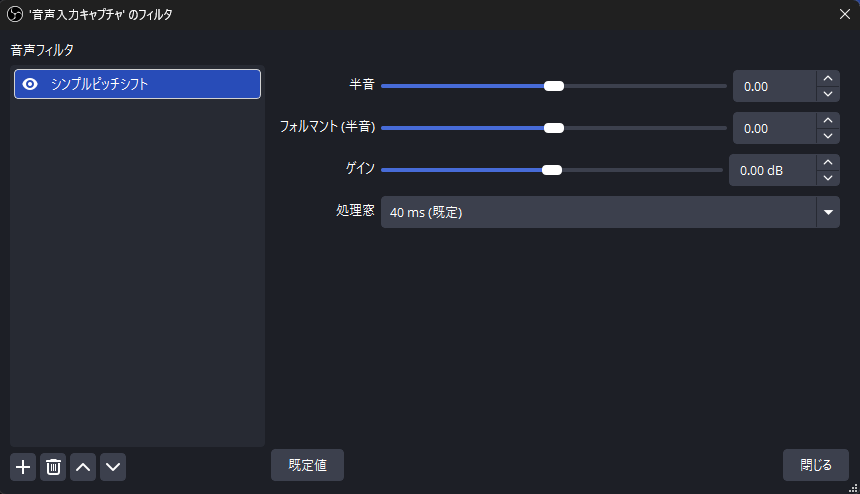

# Simple Pitch Shift



OBS Studio 向けのピッチシフト音声フィルターです。スライダーを操作して、話し声や歌声の高さ、声質、音量を変更できます。Signalsmith Stretch による声質保持を有効にし、元の声の特徴を保ちながらリアルタイムで処理します。

[配信プラグイン倉庫くん](https://soko-kun.allegromoltov.jp/plugins/allegromoltov/obs-simple-pitchshift) にも掲載しています。 / Also listed on [Plugin Soko-kun](https://soko-kun.allegromoltov.jp/plugins/allegromoltov/obs-simple-pitchshift?lang=en).

## 機能

- 音声フィルター「シンプルピッチシフト / Simple Pitch Shift」を追加できます。
- 半音を `-12.0` から `+12.0` まで 0.1 刻みで変更できます。
- フォルマントを `-12.0` から `+12.0` 半音まで 0.1 刻みで変更できます。声の高さを保ったまま声質を変えられます。
- ゲインを `-30.0` から `+30.0` dB まで 0.1 刻みで変更できます。ピッチ処理の後に適用します。
- 処理窓を 20 ms、30 ms、40 ms から選べます。短いほど遅延が小さく、音質が下がります。既定値は 40 ms です。
- 半音とフォルマントがともに `0` の場合は、ピッチ処理を通さず遅延を加えません。
- 44.1 kHz と 48 kHz のステレオ音声に対応します。声質補正の基音概算は 180 Hz 固定です。

## 動作環境

- Windows 11 x64
- OBS Studio 33 以降。実機検証に使用した版は 33.0.1 です。
- サンプルレート 44.1 kHz または 48 kHz、2 チャンネルのステレオ音声

Windows 向けに ZIP を配布します。macOS と Linux のビルドは CI で成功しています。両 OS の実機動作は未確認です。

OBS Studio 32 以前を使用する場合は、従来の配置形式の [v0.1.0](https://github.com/AllegroMoltoV/obs-simple-pitchshift/releases/tag/v0.1.0) を参照してください。旧 OBS の全バージョンでの動作を保証する案内ではありません。

## インストールと更新

### 通常版の OBS Studio

1. OBS Studio を終了します。
2. [GitHub Releases](https://github.com/AllegroMoltoV/obs-simple-pitchshift/releases) から Windows 用 ZIP をダウンロードして展開します。
3. エクスプローラーのアドレス欄に `%PROGRAMDATA%` を入力して開きます。この方法で隠しフォルダーを表示できます。
4. `obs-studio` フォルダーと、その中の `plugins` フォルダーを開きます。存在しないフォルダーを作成します。
5. 展開した `simple-pitchshift` フォルダーごと `plugins` へコピーします。更新時も同じ場所へ上書きします。Windows が管理者の許可を求めた場合は、内容を確認して許可します。
6. OBS Studio を起動します。

配置後の構成は次のとおりです。`simple-pitchshift` を二重に入れ子にしないでください。

```text
%PROGRAMDATA%\obs-studio\plugins\simple-pitchshift\
  simple-pitchshift.dll
  data\
    locale\
    licenses\
```

### ポータブル版の OBS Studio

OBS Studio を終了し、ZIP 内の `simple-pitchshift` フォルダーを OBS 本体のルートにある `plugins` へコピーします。`plugins` がなければ作成します。通常版の導入先と異なります。

```text
OBS のルート\
  bin\
  plugins\
    simple-pitchshift\
      simple-pitchshift.dll
      data\
        locale\
        licenses\
```

### 旧版からの更新

既存のシーンや半音設定を引き継げるよう、フィルターの識別子と設定キーを維持しています。ZIP の製品フォルダーを上書きする手順を使用します。v1.0.0 の設定は、処理窓 40 ms、フォルマント 0、ゲイン 0 dB として読み込まれ、従来と同じ音で動作します。

OBS Studio 33.0.1 の更新検証では、ProgramData の製品フォルダー内にある旧 `bin/64bit` の DLL を保持し、新しい配置の DLL が優先されることを確認しました。半音設定とフィルターの有効状態も引き継ぎました。

OBS 本体の `obs-plugins` へ旧版を手動配置している場合は、旧版 ZIP のファイル一覧と照合し、この製品に属するファイルだけを OBS の探索対象外へバックアップしてから、新しい配置へ導入します。他のプラグインや OBS 本体のファイルを移動しないでください。

## 使い方

1. 音声付きソースの「フィルタ」を開きます。
2. 音声フィルターに「シンプルピッチシフト / Simple Pitch Shift」を追加します。
3. 「半音 / Semitone」スライダーで音声の高さを変更します。
4. 必要に応じて「フォルマント / Formant」で声質を、「ゲイン / Gain」で音量を調整します。
5. 遅延を小さくしたい場合は「処理窓 / Processing window」で 30 ms または 20 ms を選びます。


## 音質と遅延

音声処理自体の遅延は、選んだ処理窓と同じ 20 ms、30 ms、40 ms です。OBS のバッファー、音声デバイス、モニタリング経路で生じる遅延を含みません。マイク入力から耳に届くまでの遅延を保証する値ではありません。

処理窓を短くすると、遅延が小さくなる代わりに音質と声質補正の精度が下がります。作者の評価では 40 ms が最も自然で、20 ms は音質の低下が目立ちます。

半音・フォルマント・ゲインの変更では処理履歴を初期化せず、スライダーの操作中も音声を途切れさせません。処理窓の変更、再有効化、半音とフォルマントがともに `0` の状態との切り替えでは処理履歴を初期化するため、短い立ち上がりが生じます。対応外のサンプルレートやチャンネル構成ではピッチ処理を通さず、ゲインだけを適用します。変換量や素材によって音質が変わるため、配信前に実際の音声で確認してください。

作者が Windows 上の通常の OBS Studio で使用感を確認しています。検証条件と測定の限界を [v1.1.0 の検証報告](docs/reports/2026-11-08-v110-verification.md) と [v1.0.0 の統合検証報告](docs/reports/2026-11-08-pitch-integration.md) に記載しています。

## ビルド

[OBS Plugin Template](https://github.com/obsproject/obs-plugintemplate) を基にしています。Windows の開発には Visual Studio 2022 と CMake 3.28 以降を使用します。

構成を生成します。

```powershell
cmake --preset windows-x64
```

`build_x64` 内のソリューションを Visual Studio で開き、`RelWithDebInfo` 構成でビルドします。ビルド後の OBS への自動導入を無効にしています。

配布用のファイルを `dist` へ配置します。

```powershell
cmake --install build_x64 --config RelWithDebInfo --prefix dist
```

Signalsmith Stretch と Signalsmith Linear の固定コミットを CMake の FetchContent で取得します。初回構成時に依存ソースの取得が必要です。

## ライセンス

本体は GPLv2 です。追加依存の Signalsmith Stretch と Signalsmith Linear は MIT ライセンスです。配布 ZIP の `data/licenses` にライセンス本文を同梱しています。採用コミットと確認結果を [追加依存ライセンス確認](docs/reports/2026-11-08-dependency-licenses.md) に記載しています。

GitHub が自動生成するソース ZIP には FetchContent の依存ソースが含まれません。各 Release の `simple-pitchshift-<版>-source-with-dependencies.tar.gz` に、製品ソース、固定コミットの依存ソース、ライセンス、同梱ソースを使用するビルド案内を収録しています。

## AI 利用開示 / AI Disclosure

### 日本語

v0.1.0 までの制作では、Anthropic Claude Code をソースコード、ビルド設定、テスト、文書を含むほぼすべての工程で使用しました。v0.1.0 のコード制作に OpenAI Codex は使用していません。

v1.0.0 の制作では、OpenAI Codex を音声処理の調査・統合、ビルドと配布設定、検証、文書、公開準備に使用しました。現在のロゴは Codex が生成した SVG から作成しています。従来のリソースアイコンは Claude Code が生成した SVG から作成しました。

v1.1.0 の制作では、Anthropic Claude Code を処理窓の選択・フォルマント・ゲインの実装、テスト、遅延の調査、文書、公開準備に使用しました。

作者本人が Windows 上の OBS Studio で使用感を確認し、v1.0.0 と v1.1.0 の音声処理を採用しました。コード読解による厳密な人間レビューは実施していません。概要説明欄で GIF は使用していません。

### English

Anthropic Claude Code was used for almost the entire development process through v0.1.0, including source code, build configuration, tests, and documentation. OpenAI Codex was not used to develop the v0.1.0 code.

For v1.0.0, OpenAI Codex was used for audio-processing research and integration, build and packaging configuration, verification, documentation, and release preparation. The current logo was created from an SVG generated by Codex. The previous resource icon was created from an SVG generated by Claude Code.

For v1.1.0, Anthropic Claude Code was used to implement the processing-window selection, formant, and gain controls, and for tests, latency investigation, documentation, and release preparation.

The author tested usability in OBS Studio on Windows and accepted the v1.0.0 and v1.1.0 audio processing. A rigorous human source-code review has not been performed. No GIF is used in the resource description.

## 更新情報

### v1.1.2

- リリースの配布物にビルドの来歴の証明 (GitHub Artifact Attestation) を付けるようにしました。プラグインの動作は v1.1.1 と同じです。
- 依存ライブラリのソースを含めたアーカイブも CI で作り、同じく証明を付けるようにしました。

### v1.1.1

2026-11-09 公開。

- 配信プラグイン倉庫くん (https://soko-kun.allegromoltov.jp) に表示するロゴと説明の画像を、`.soko-kun/` に追加しました。音声処理の変更はありません。

### v1.1.0

2026-11-08 公開。[公開検証報告](docs/reports/2026-11-08-v110-verification.md) に検証結果と配布物を記録しています。

- 処理窓を 20 ms、30 ms、40 ms から選べるようにしました。既定値は従来と同じ 40 ms です。
- フォルマントとゲインのスライダーを追加しました。
- 半音を 0.1 刻みで変更できるようにしました。
- 半音の変更で処理履歴を初期化しないようにし、スライダー操作中の途切れをなくしました。
- v1.0.0 の保存設定をそのまま読み込めます。

### v1.0.0

2026-11-08 公開。[公開検証報告](docs/reports/2026-11-08-v100-publish.md) に配布物と公開状態を記録しています。

- Signalsmith Stretch による声質保持と 40 ms の音声処理を採用しました。
- 既存の半音設定と 0 半音でのバイパスを維持しました。
- Windows の配置を OBS Studio 33 以降のプラグインフォルダー形式へ変更しました。
- ロゴとライセンス同梱を更新しました。
- 英語のフィルター名が `Simple` で途切れる表示を修正しました。

### v0.1.0

従来のピッチシフト処理と Windows 配置形式を使用する旧版です。[旧版 Release](https://github.com/AllegroMoltoV/obs-simple-pitchshift/releases/tag/v0.1.0) を保持しています。
